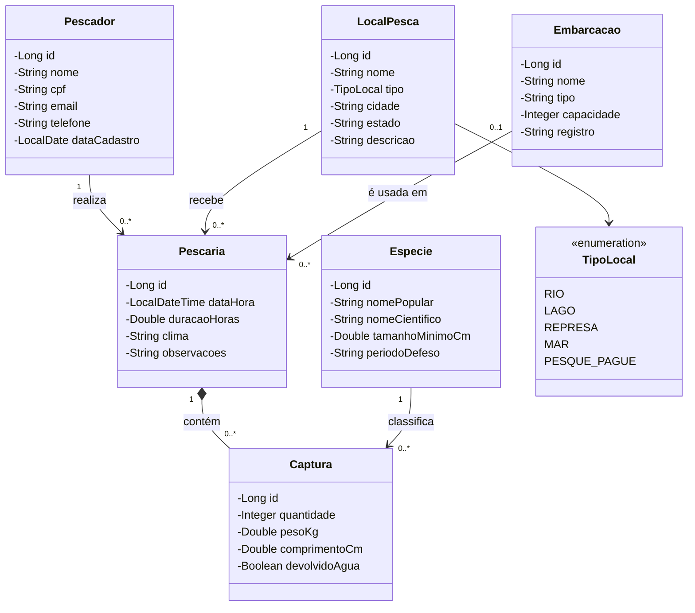
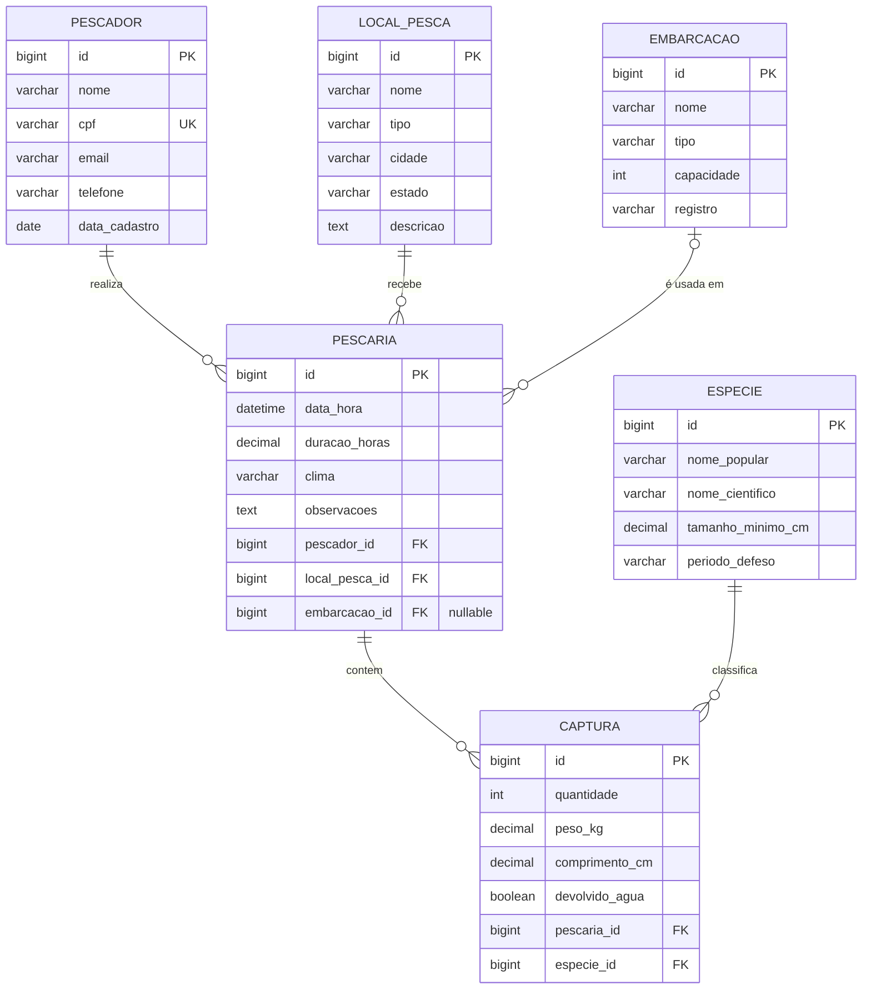

# 🎣 Sistema de Gestão de Pescarias

Atividade: Sistema WEB com Spring Framework (Spring MVC, Thymeleaf, Spring Data JPA)

**Equipe:** Matthäus de Paula, João Gabriel Nasario, Nicolas Rodrigues, Rafaela Gusczak

---

## 1. Tema

Sistema para pescadores registrarem suas saídas de pesca: quem pescou, onde, com qual embarcação e o que foi capturado. Permite consultar o histórico de pescarias e acompanhar as espécies capturadas, inclusive as que foram devolvidas à água (pesque e solte).

### Entidades (6 tabelas)

| Entidade | Descrição |
|---|---|
| Pescador | Pessoa que realiza as pescarias |
| LocalPesca | Rio, lago, represa ou ponto no mar onde se pesca |
| Embarcacao | Barco/caiaque usado na saída (opcional) |
| Especie | Espécie de peixe, com tamanho mínimo e período de defeso |
| Pescaria | Saída de pesca (data, clima, pescador, local, embarcação) |
| Captura | Item capturado numa pescaria (espécie, quantidade, peso, tamanho) |

### Relacionamentos

- Um **Pescador** realiza muitas **Pescarias** (1:N)
- Um **LocalPesca** recebe muitas **Pescarias** (1:N)
- Uma **Embarcacao** é usada em muitas **Pescarias** (1:N, opcional)
- Uma **Pescaria** possui muitas **Capturas** (1:N)
- Uma **Especie** aparece em muitas **Capturas** (1:N)
- Pescaria ↔ Especie é N:N, resolvido pela entidade **Captura**

### CRUDs

Cada entidade terá cadastro, edição, exclusão e listagem: Pescador, LocalPesca, Embarcacao, Especie, Pescaria e Captura (esta última dentro do detalhe da pescaria).

---

## 2. Protótipos de tela

🔗 **Link do protótipo (Figma):** https://www.figma.com/design/KkDgZFPhHDq2SnqdfmxqC3

> Os dados exibidos nas telas são fictícios, apenas para ilustrar o protótipo.

Telas previstas:

1. Home / dashboard (últimas pescarias, total capturado)
2. Listagem de pescadores
3. Formulário de pescador (cadastro/edição)
4. Listagem de locais de pesca
5. Formulário de local de pesca
6. Listagem de embarcações
7. Formulário de embarcação
8. Listagem de espécies
9. Formulário de espécie
10. Listagem de pescarias (com filtro por pescador/local)
11. Formulário de pescaria
12. Detalhe da pescaria com lista de capturas e formulário para adicionar captura

---

## 3. Diagrama de classes



---

## 4. Diagrama MER



---

## 5. Tecnologias

- Java 17+ e Spring Boot 3.5
- Spring MVC + Thymeleaf
- Spring Data JPA (Hibernate) + Bean Validation
- PostgreSQL hospedado no [Neon](https://neon.com) (plano gratuito)

### Estrutura do projeto

```
src/main/java/br/univille/pescaria
├── PescariaApplication.java   # classe principal
├── model/                     # entidades JPA (as 6 tabelas + enum TipoLocal)
├── repository/                # interfaces Spring Data
├── controller/                # controllers do Spring MVC (um por CRUD)
└── config/                    # dados de exemplo e formatação de números
src/main/resources
├── application.properties     # configuração (sem senhas)
├── templates/                 # páginas Thymeleaf
└── static/css/style.css       # estilos
```

---

## 6. Como rodar

### 6.1 Banco de dados

O banco já está criado no [Neon](https://neon.com) (PostgreSQL, região São Paulo), e o acesso está no arquivo `db.properties`, na raiz do projeto. **Não é preciso configurar nada**: basta clonar e executar.

> O plano gratuito do Neon desliga o banco depois de 5 minutos sem uso e liga de novo na conexão seguinte. A primeira página carregada depois de um tempo parado pode demorar alguns segundos a mais.

> Os dados de acesso estão no repositório de propósito, para facilitar a avaliação. O banco é usado só para este trabalho acadêmico.

> Algumas redes (empresas, faculdades) bloqueiam a porta 5432 do PostgreSQL. Se o console mostrar `Connect timed out`, teste com `Test-NetConnection <host-do-neon> -Port 5432` no PowerShell e, se for bloqueio, use outra rede (por exemplo, o roteador do celular).

Na primeira execução com o banco vazio, o sistema cadastra **dados de exemplo** (pescadores, locais, embarcações, espécies e algumas pescarias com capturas). Para desligar, use `pescaria.dados-exemplo=false` no `application.properties`.

### 6.2 Executar

- **IntelliJ IDEA:** abra a pasta do projeto, espere o Maven baixar as dependências e rode a classe `PescariaApplication`.
- **VS Code:** instale o *Extension Pack for Java* e o *Spring Boot Extension Pack*, abra a pasta e rode `PescariaApplication`.
- **Terminal (com Maven instalado):** `mvn spring-boot:run`

Depois, acesse http://localhost:8080. As tabelas são criadas automaticamente no primeiro start (`spring.jpa.hibernate.ddl-auto=update`).
